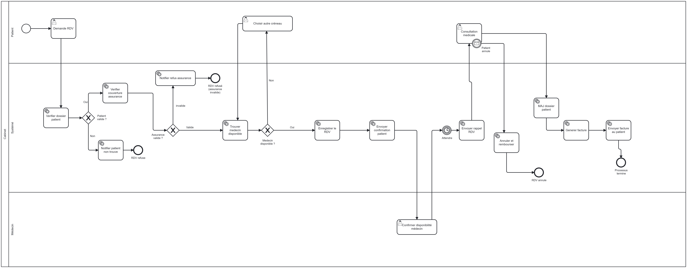

# Gestion des rendez-vous médicaux avec Zeebe et BPMN

Automatisation du processus de **prise de rendez-vous médical** avec **Camunda 8 (Zeebe)**. Le projet modélise le parcours complet d'un patient en BPMN, depuis la demande de rendez-vous jusqu'à l'envoi de la facture, et l'exécute grâce à une application **Spring Boot** qui implémente les tâches automatisées (job workers).

## Sommaire

- [Description du processus](#description-du-processus)
- [Modèle BPMN](#modèle-bpmn)
- [Formulaires](#formulaires)
- [Job workers](#job-workers)
- [Structure du projet](#structure-du-projet)
- [Installation et lancement](#installation-et-lancement)
- [Configuration](#configuration)
- [Technologies utilisées](#technologies-utilisées)

## Description du processus

Le processus implique trois acteurs : le **patient**, le **système** et le **médecin** (au sein du cabinet).

1. **Demande de RDV** : le patient renseigne son identifiant, son nom, la date souhaitée et la spécialité.
2. **Vérification du dossier patient** : si le patient n'est pas reconnu, il est notifié et le RDV est refusé.
3. **Vérification de la couverture d'assurance** : si l'assurance est invalide, le patient est notifié et le RDV est refusé.
4. **Recherche d'un médecin disponible** : si aucun médecin n'est disponible, le patient choisit un autre créneau et la recherche est relancée.
5. **Enregistrement du RDV** et **envoi de la confirmation** au patient.
6. **Confirmation de disponibilité** par le médecin (tâche utilisateur).
7. **Attente jusqu'à la veille du RDV**, puis **envoi d'un rappel** au patient.
8. **Consultation médicale** : le médecin saisit le diagnostic, le traitement prescrit et le montant de la facture.
9. **Mise à jour du dossier patient**, **génération de la facture** puis **envoi de la facture** au patient.

À tout moment avant la consultation, le patient peut **annuler** son RDV : un message `annulation-rdv` déclenche alors l'annulation et le remboursement.

## Modèle BPMN

Le diagramme est fourni dans `PriseRDV.bpmn` (aperçu : `PriseRDV.png`). Il s'ouvre dans [Camunda Modeler](https://camunda.com/download/modeler/).



### Passerelles et conditions

| Passerelle | Conditions |
|---|---|
| Patient valide ? | `patientValid = true` / `patientValid = false` |
| Assurance valide ? | `assuranceValide = true` / `assuranceValide = false` |
| Médecin disponible ? | `medecinDisponible = true` / `medecinDisponible = false` |

### Événements

- **Événement minuteur** « Attendre (j-1) » : durée configurée à `PT30S` pour faciliter les tests. Pour un usage réel, remplacez-la par le délai voulu avant la date du RDV.
- **Événement frontière de message** « Patient annule » : message `annulation-rdv`, corrélé par la variable `appointmentId`.

## Formulaires

| Fichier | Tâche utilisateur | Champs |
|---|---|---|
| `form_1.form` | Demande RDV | `patientId`, `patientName`, `dateRDV`, `specialite` |
| `confirm_dispo_medecin.form` | Confirmer disponibilité médecin | `medecinId`, `medecinDisponible` |
| `consultation_medicale.form` | Consultation médicale | Diagnostic, traitement prescrit, `montantFacture` |
| `form_2.form` | Choisir autre créneau | Date |

## Job workers

Les workers se trouvent dans `priseRDV/src/main/java/com/example/priseRDV/` et sont déclarés avec l'annotation `@JobWorker`.

| Type de job | Classe | Rôle | Variables produites |
|---|---|---|---|
| `verify-patient` | `PatientWorker` | Vérifie le dossier du patient | `patientValid` |
| `check-insurance` | `InsuranceWorker` | Vérifie la couverture d'assurance | `assuranceValide` |
| `find-doctor` | `DoctorWorker` | Recherche un médecin disponible | `medecinDisponible`, `medecinId` |
| `register-appointment` | `RegisterAppointmentWorker` | Enregistre le RDV | `appointmentId` |
| `send-confirmation` | `SendConfirmationWorker` | Envoie la confirmation au patient | |
| `send-reminder` | `SendReminderWorker` | Envoie le rappel au patient | |
| `cancel-refund` | `CancelRefundWorker` | Annule le RDV et rembourse | |
| `update-patient-file` | `UpdatePatientFileWorker` | Met à jour le dossier patient | |
| `generate-invoice` | `GenerateInvoiceWorker` | Génère la facture | `factureId`, `montantFacture` |
| `send-invoice` | `SendInvoiceWorker` | Envoie la facture au patient | |

## Structure du projet

```
gestion-rdv-zeebe-bpmn/
├── PriseRDV.bpmn                  Modèle BPMN du processus
├── PriseRDV.png                   Image du diagramme
├── form_1.form                    Formulaire de demande de RDV
├── confirm_dispo_medecin.form     Formulaire de confirmation du médecin
├── consultation_medicale.form     Formulaire de consultation
├── form_2.form                    Formulaire de choix d'un autre créneau
└── priseRDV/                      Application Spring Boot (job workers)
    ├── pom.xml
    └── src/main/
        ├── java/com/example/priseRDV/   Workers Zeebe
        └── resources/application.properties
```

## Installation et lancement

### Prérequis

- Java 21
- Maven (ou le wrapper `mvnw` fourni)
- Un cluster Camunda 8 / Zeebe accessible (par exemple en local avec Docker, ou Camunda 8 SaaS)
- [Camunda Modeler](https://camunda.com/download/modeler/) pour déployer le processus

### 1. Cloner le dépôt

```bash
git clone https://github.com/siwarmrayhi/gestion-rdv-zeebe-bpmn.git
cd gestion-rdv-zeebe-bpmn
```

### 2. Déployer le processus

Dans Camunda Modeler, ouvrez `PriseRDV.bpmn` et déployez-le sur votre cluster avec les quatre fichiers `.form`.

### 3. Lancer les workers

```bash
cd priseRDV
./mvnw spring-boot:run        # Windows : mvnw.cmd spring-boot:run
```

L'application démarre sur `http://localhost:8081` et se connecte à Zeebe.

### 4. Démarrer une instance

Démarrez une instance du processus depuis Camunda Modeler ou **Tasklist**, puis remplissez le formulaire « Demande RDV ». Les messages des workers s'affichent dans la console de l'application.

Pour annuler un RDV en cours, publiez le message `annulation-rdv` avec `appointmentId` comme clé de corrélation.

## Configuration

Fichier `priseRDV/src/main/resources/application.properties` :

| Propriété | Valeur | Description |
|---|---|---|
| `server.port` | `8081` | Port de l'application Spring Boot |
| `zeebe.client.broker.gateway-address` | `127.0.0.1:26500` | Adresse de la passerelle Zeebe (sans `http://`) |
| `zeebe.client.security.plaintext` | `true` | Connexion non chiffrée (usage local) |

Pour un cluster Camunda 8 SaaS, remplacez ces propriétés par celles du client (identifiant de cluster, client ID et client secret) fournies par la console Camunda, sans jamais les committer.


## Technologies utilisées

- **Camunda 8 / Zeebe** : moteur de workflow
- **BPMN 2.0** et **Camunda Forms** : modélisation du processus et formulaires
- **Spring Boot 3.5** et Java 21
- **Camunda Spring Boot Starter 8.5** : client Zeebe et job workers
- **Maven**
